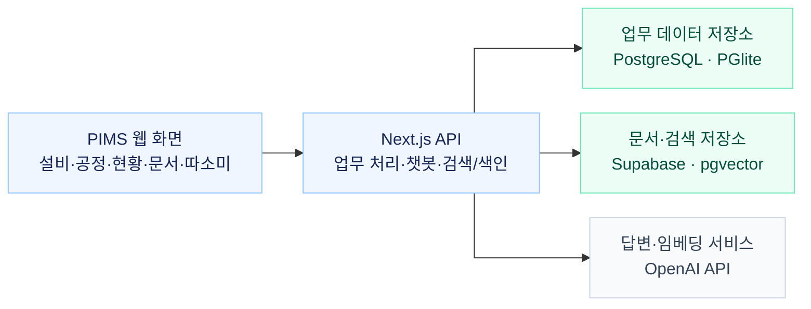
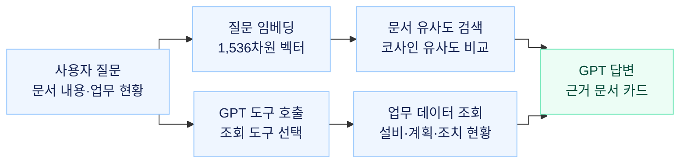

<h1 align="center">PIMS · 플랜트 지능형 관리시스템</h1>

<p align="center"><sub>Plant Intelligence Management System</sub></p>

<p align="center">
  지역난방 플랜트의 보수계획·현장 기록·조치 현황을 한곳에서 관리합니다.<br>
  사진과 설명으로 보고서를 만들고, 쌓인 기록을 다음 정비에 다시 활용합니다.
</p>

<p align="center">
  <strong><a href="https://plant-ops-hub.vercel.app">서비스 접속 ↗</a></strong>
  &nbsp;·&nbsp; <a href="#주요-기능과-사용-흐름">주요 기능</a>
  &nbsp;·&nbsp; <a href="#빠른-시작">실행 방법</a>
  &nbsp;·&nbsp; <a href="#아키텍처와-핵심-기술">기술 구조</a>
</p>

## 주요 기능과 사용 흐름

| 업무 | PIMS에서 하는 일 |
|---|---|
| 설비·공정 | 엑셀 보수계획에서 정비 대상을 산출하고, 작업 일정과 실적을 함께 관리합니다. |
| 매뉴얼·고장보고서 | 사진과 설명을 A4 문서로 구성하고 PDF와 편집 원본을 보관합니다. |
| 현황·조치 | 운영부가 발견사항을 등록하면 유지보수 담당자가 조치 내용과 상태를 갱신합니다. |
| 정비 챗봇 따소미 | 설비·보수계획·조치 현황을 조회하고, 매뉴얼과 고장보고서를 근거로 답합니다. |

**현장 이슈 등록 → 기본 항목을 이어받아 보고서 작성 → PDF 보관 → 조치 추적·기록 검색**

보고서 재편집과 항목 재입력을 줄이고, 인계한 이슈의 조치 결과를 같은 목록에서 확인합니다.

## 빠른 시작

**준비 환경:** Node.js 20.9 이상, npm.

```bash
git clone https://github.com/Quietmin/tonghapbon-1.git
cd tonghapbon-1
npm ci
npm run dev
```

[localhost:3000](http://localhost:3000)에서 지사와 부서를 선택합니다. 별도 DB 설정 없이 PGlite가 `.data/pgdata`에 업무 데이터를 저장합니다.

공유 DB·문서 보관·AI를 사용하려면 [.env.local.example](.env.local.example)을 `.env.local`로 복사하고 아래 값을 설정합니다.

| 기능 | 환경변수 |
|---|---|
| 공유 PostgreSQL | `DATABASE_URL` |
| 문서 보관함 | `NEXT_PUBLIC_DOCGEN_SUPABASE_URL`, `NEXT_PUBLIC_DOCGEN_SUPABASE_ANON_KEY` |
| AI 답변·문서 검색 | `GPT_CHAT_ENABLED=true`, `OPENAI_API_KEY` |

공유 DB는 `npm run db:migrate`로 초기화합니다. 문서용 Supabase에는 [문서 스키마 SQL](supabase/docgen)을 `01`부터 `04`까지 순서대로 적용합니다. OpenAI 키는 서버에서만 사용합니다.

배포용 실행은 `npm run build` 후 `npm start`입니다.

## 아키텍처와 핵심 기술

Next.js 16 · React 19 · TypeScript · PostgreSQL · Supabase · OpenAI



업무 API는 계획·실적·현황을 처리하고, 챗봇 API는 업무 DB와 문서 색인을 조회합니다. 문서 원본·PDF는 브라우저에서 Supabase에 직접 저장합니다.

### 따소미: 문서 저장에서 답변까지

**1. 문서 저장·임베딩** — 매뉴얼·고장보고서의 PDF와 원본을 저장한 뒤 비동기로 색인을 만듭니다.


원문은 항목별로 나누고, 긴 항목은 문장 경계를 고려해 분할합니다. 문서와 질문은 모두 `text-embedding-3-small`로 벡터화합니다.

**2. 질문·검색·답변** — 문서의 내용은 유사도 검색으로, 설비·보수계획·현황은 업무 조회 도구로 찾습니다.



유사도 상위 24개 조각에서 낮은 점수의 결과를 제외해 최대 5개 문서로 묶고, 질문 핵심어와 점수로 관련성을 검사합니다. GPT가 선택한 **읽기 전용 도구**는 서버가 실행하며, 문서 발췌·조회 결과를 답변에 사용합니다.

[문서 분할](src/modules/docgen/lib/searchText.ts) · [임베딩·색인](src/app/api/docgen/index/route.ts) · [유사도 검색](src/app/api/docgen/search/route.ts) · [도구 호출·답변](src/app/api/overhaul/chatbot/route.ts)

- **보수 판정:** 엑셀의 설비명·주기·이력을 정규화하고, `마지막 보수연도 + 주기`로 정비 대상을 계산합니다. 보수 실적을 반영하면 다음 판정도 갱신됩니다.
- **확장 구조:** 19개 지사에 공통 화면을 제공하고 지사별 계획·실적·현황을 조회합니다. 업무 모듈과 DB 접근 계층을 분리해 설비와 업무를 추가할 때 공통 구조를 재사용합니다.

## 프로젝트 구성과 문서

```text
src/app/       화면과 API 라우트
src/modules/   설비·공정·문서·현황·챗봇 업무 로직
src/shared/    공통 UI, 지사·부서 설정, DB 접근
db/            업무 데이터 스키마
supabase/      문서 보관·검색 스키마
```

[샘플 엑셀·사용 순서](샘플자료/README.md) · [업무 DB 스키마](db/schema.sql) · [오버홀 설계서](docs/OH%20WEB%20APP%20PRD.md)
